Software Básico

<!-- 
#TODO: contextualização do software básico, mudança de BIOS para firmware
-->
# Introdução

Software Básico/Softwate de Sistema é o conjunto de programas necessários para operar e controlar o hardware de um computador, além de providenciar uma plataforma para execução de aplicações.

exemplos:
- Sistema Operacinal, que administra programas e hardware
- BIOS (Basic Input/Output System) testa e inicia os componentes de hardware do sistema. Chama  carregador do OS e implementa uma interface entre ele e o hardware (incluindo periféricos)
- bootloader que carrega o OS
- *drivers* específicos de hardware (HD, drivers usb, GPU, etc.). Converte instruções gerais de I/O do sistemas para mensagems adequadas para o dispositivo alvo
- *firmware* em computadores e embarcados (nesse segundo, é o software que controla o sistema)

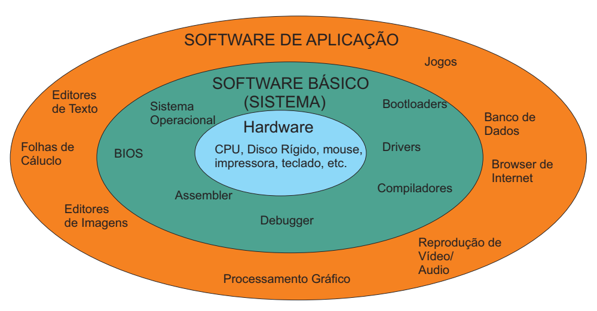

algumas classes de software de sistema:
- *Assembler*/Montador converte instruções em assembly para linguagem de máquina
- *Loader*/Carregador carrega o programa a ser executado em memória
- *Linker*/Ligador combina múltiplos arquivos objeto e resolve as referências entre eles
- Ferramentas de Desenvolvimento, como Compiladores e Debuggers
- Utilitários como desfragmentador de disco e *system restore* (alguns não consideram software de sistema)

## Estrutura de memória

a memória principal de um computador é organizada em endereços, cada um possuindo a mesma capacidade de armazenamento. na maioria das arquiteturas (depende da CPU) os endereços possuem 8 bits / 1 byte

considerando uma arquitetura Von Neumman, os programas ativos também devem ser carregados em memória

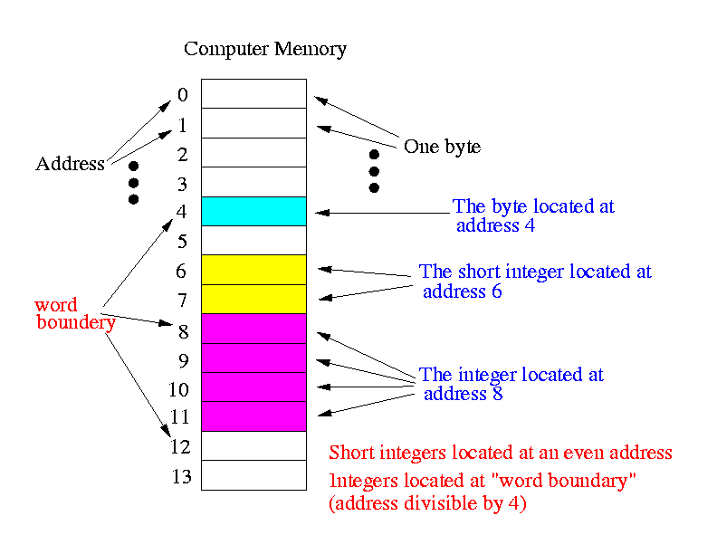


## CPU e Código de Máquina

a Arquitetura de um processador indica qual é a linguagem de máquina que ele reconhece para operar. a ISA (*Instruction Set Architecture*) é o conjunto de instruções que um processador implementa, um modelo abstrado que representa a interface da CPU, definindo como o software opera o hardware

a Organização de um processador é a implementação do processador, visando realizar as operações da ISA (estrutura física, conexões, unidades de memória, controladores, interfaces com hardware externo, etc.)

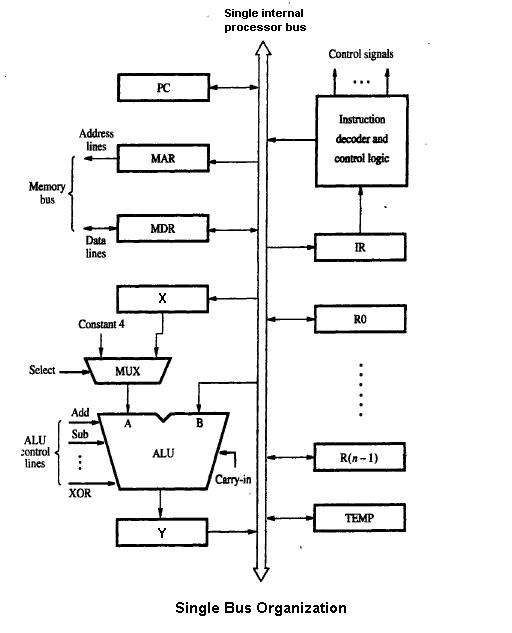

<br>

as instruções de código/linguagem de máquina são números binários codificados com:
- *opcode* e demais códigos: valores que identificam a operação a ser realizada
- argumentos: registradores a ser lidos/escritos ou valores (imediatos ou endereços), que serão utilizados na operação
- *flags* e outros valores: informações adicionais da instrução (prefixos em x86-64, )

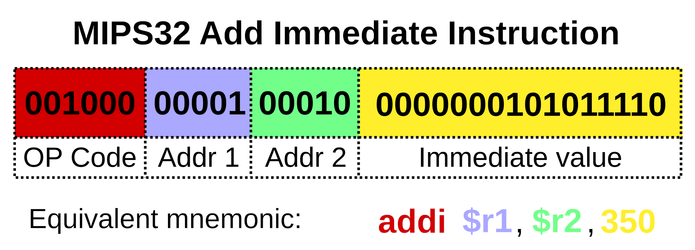

<br>

a CPU lê uma instrução por vez e a executa. ela precisa dos seguintes componentes para isso:

- ***Program Counter*/Contador de Programa (PC)**: registrador que indica a posição na memória da próxima instrução

- **Decodificador de Instrução**: identifica o significado de uma instrução em linguagem de máquina

- **Barramento de Dados**: canal de comunicação entre memória e CPU para dados e instruções

- **Registradores**: existem 2 tipos

  - os de uso geral (General Purpose Registers) são utilizados na maioria das operações, com propósito genérico (guardam resultados de operação, endereços da memória de dados, etc.). são plenamente acessíveis pelo programa

  - os de uso específico (Special-Purpose / Dedicated Registers) são reservados para funções de controle do processador (controle de fluxo,  pilha de dados, controle e status, etc.). podem ser de uso estritamente automático pela CPU; dependem da arquitetura e organização
  
- **Unidade Lógica e Aritmética (ALU)**: realiza as operações lógicas e aritméticas 

## Baixo vs. Alto Nível

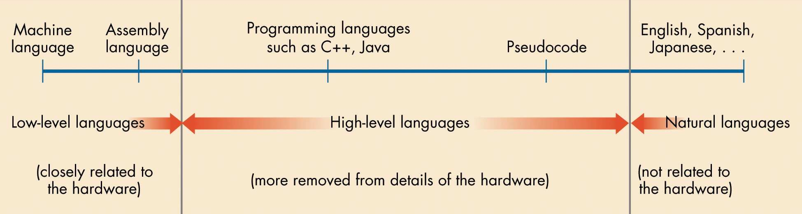


# Tradução

## Interpretador

facilitam debugging, permitindo monitoramento em alto nível

facilitam a portabilidade do programa para sistemas. foco na compatibilidade da execução da linguagem intermediária (rotinas pré-compiladas)

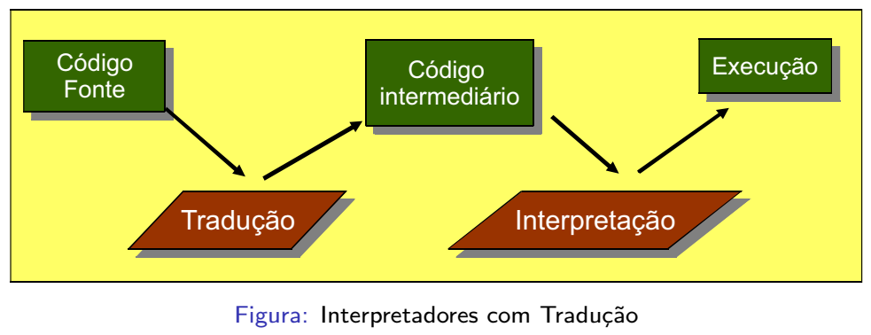

## Compilador

- análise sintática
- alocação estática
- ligação estática
- otimização de código

> [!note] obs:
> um compilador pode tanto gerar um programa diretamente em linguagem de máquina quanto traduzir para um programa em assembly e chamar um montador para gerar o programa em linguagem de máquina

# Fases de compilação

estrutura de um tradutor:
- Análise
  - Analisador Léxico
  - Analisador Sintático
  - Analisador Semântico

- Síntese
  - Geração de código intermediário
  - Otimização de código
  - Geração de código objeto

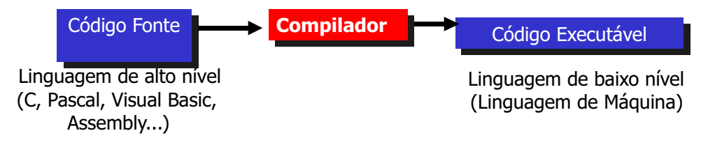

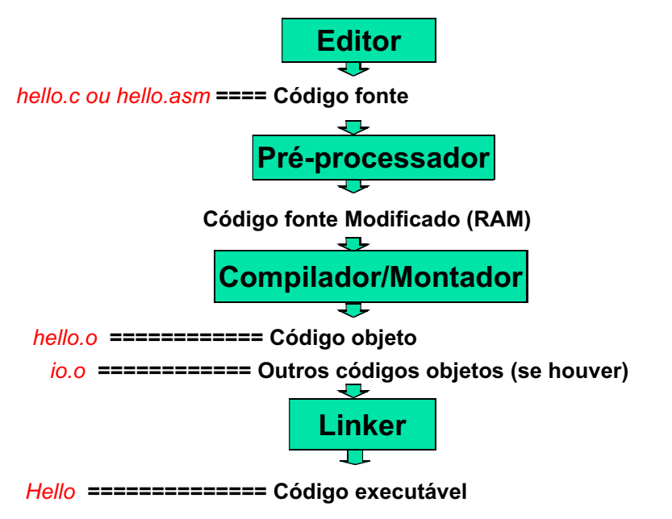


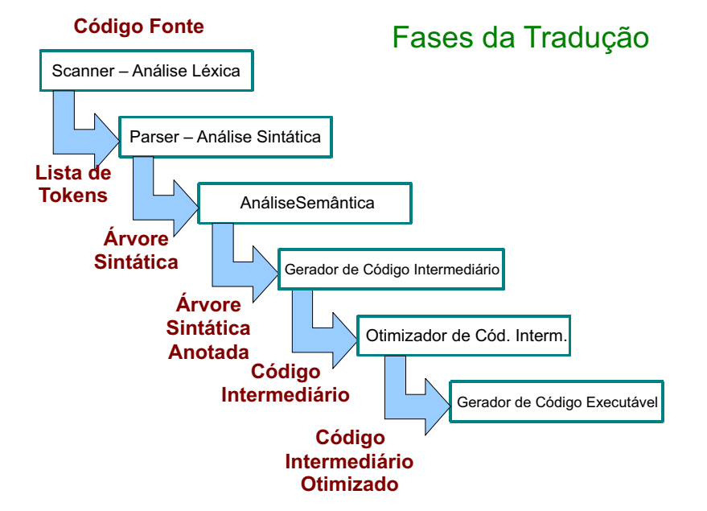

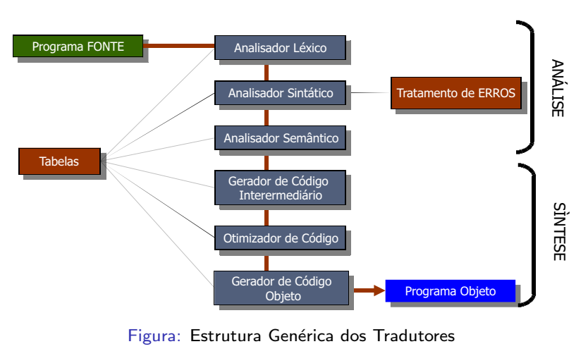

Etapa de **análise**: decompõe o programa fonte e cira uma representação intermediária estruturada \
Etapa de **síntese**: constrói o programa objeto a partir da representação intermediária

token: unidade básica de informação para uma linguagem de programação \
ex: literal, função, operador, pontuação, palavra reservada, termo


| Fase                               | Causas de erro                                        |
| ---------------------------------- | ----------------------------------------------------- |
| Análise Léxica                     | impossível converter para tokens, erros de escrita    |
| Análise Sintática                  | erros de sintaxe (estrutura)                          |
| Análise Semântica                  | erros entre comandos/instruções (lógica, mal-tipagem) |
| Gerador de Código Intermediário    | a                                                     |
| Otimizador de Código Intermediário | a                                                     |
| Gerador de Código Executável       | a                                                     |


## Análise

### Análise Léxica (Scanner)

geralmente, subrotina do Parser para identificar novos tokens

identificar caracteres e agrupar em tokens (e ignorar comentários)
- palavras reservadas
- constantes/literais
- identificadores

construção da tabela de símbolos e cadeia de tokens

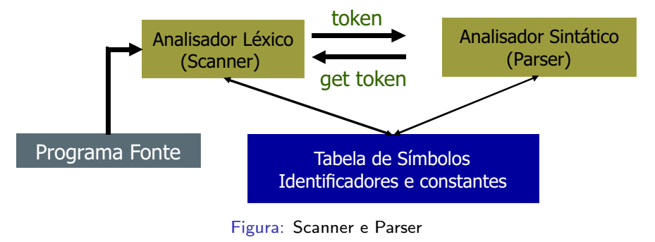

### Análise Sintática (Parser)

realizar varredura (parsing) na cadeia de tokens pra checar compatibilidade da estrutura gramatical do programa com as regras da linguagem
- reconhecer comandos e estruturas da linguagem
- construção de representação em Árvore de Derivação/Sintaxe
- em geral, aplicar desugaring


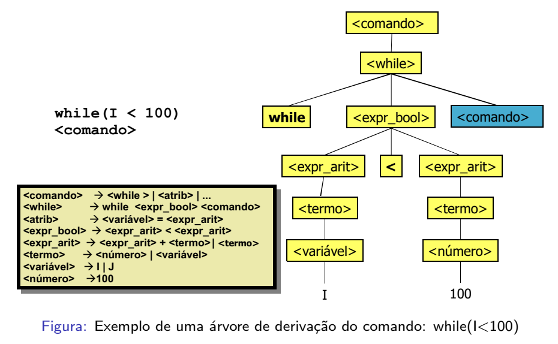

### Análise Semântica

verificações
- tipagem
- fluxo de controle
- unicidade da declaração de variáveis

produz:
- "conversões automáticas" de tipos (cast char/int, castings com warning)
- recebe a árvore de derivação e produz uma árvore anotada/semanticamente correta

## Síntese

### Geração de código intermediário

geralmente, são usados: código de três endereços e notação pósfixa (notação polonesa invertida)

#### Código de três endereços

linguagem independente de arquitetura em que toda expressão acessa no máximo 3 endereços (variáveis, operações, expressões)

dispõe de instruções:
- atribuição simples\
    `x := y`
- operações unárias e binárias\
    `x := y op z`, `x := op y`
- pulos condicionais e incondicionais\
    `goto _L`\
    `if x op y goto _L`

a implementação do código deve ser uma tabela com 3 colunas (desconsiderando o endereço da instrução)

para as operações abaixo, poderíamos ter a tabela:\
`a = b + c * d;`

tabela 1:1

| instr | operação | arg1 | arg2 | resultado |
| ----- | -------- | ---- | ---- | --------- |
| 1     | *        | c    | d    | _t1       |
| 2     | +        | b    | _t1  | a         |

tabela em código de três endereços

| instr | operação | arg1 | arg2 |
| ----- | -------- | ---- | ---- |
| 1     | *        | c    | d    |
| 2     | +        | b    | (1)  |

podemos omitir a coluna de resultados, pois o armazenamento e referenciação do resultado de cada instrução é responsabilidade do compilador. a instrução 2 utiliza o resultado (1) da instrução 1

#### Notação pósfixa

como é mais fácil implementar em hardware uma memória de pilha que uma memória de livre acesso de endereço, naturalmente a notação pósfixa permite implementações mais simples de hardware (e de alguma forma deve otimizar a execução)

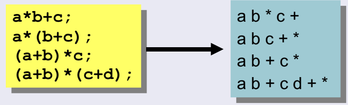

#### Otimizações simples

obs: no início do desenvolvimento dos compiladores, não era possível otimizar qualquer programa para qualquer plataforma: a otimização era necessariamente ligada à arquitetura de um hardware específico, sendo necessário conhecer a implementação alvo para fazer qualquer otimização interna do código

1. garantir que duas expressões não fazem exatamente a mesma coisa\
    duas expressões não devem usar o mesmo operador sobre os mesmos argumentos (obedecendo restrições e exceções do hardware considerado)

2. garantir que, em todo loop, não haja instruções que independem do loop\
    essas instruções independentes são apenas executadas várias vezes e produzem o mesmo resultado, pois independe de qual iteração do loop ela é executada

    então podemos executá-las antes do loop

# Montador

## Assembly inventado

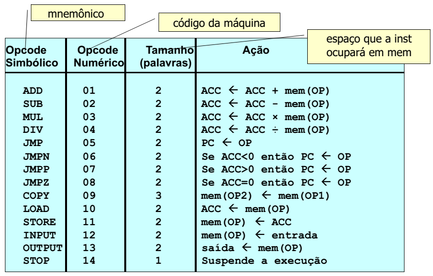

> [!note] obs: 
> `COPY` é a única instrução que não se implementa em assembly real, pois acessa dois endereços de memória ao mesmo tempo. na prática, é uma instrução de `load` lendo da memória e outra de `store` escrevendo na memória


nosso montador deve gerar um código (intermediário ou objeto) para nosso assembly inventado, realizando as tarefas:
- tradução de pseudo-instruções para opcodes e expansão de macros
- reserva espaço para dados
- resolver referências a endereços de memória no programa
- registrar informações para a ligação do programa
  - tabela de definições: símbolos externos utilizados no programa
  - tabela de uso: símbolos exportados e atributos

para isso, o montador deve percorrer o código fonte linha a linha para gerar o binário correspondente. é possível fazer isso em duas passagens ou uma única

hoje em dia, em geral, os compiladores usam apenas o algoritmo de duas passagens (a diferença de tempo costuma ser imperceptível para o usuário e deve adiantar processos de otimização)

*forward reference problem*: como resolver o endereço de um rótulo usado numa instrução sem ter chegado na definição do rótulo ainda?

## Algoritmo de duas passagens (two-pass assembler)

um símbolo é um rótulo ou nome de uma variável declarada

primeira passagem: identifica símbolos, rótulos, etc. e os armazena numa tabela de símbolos (TS)

segunda passagem: determina os endereços dos símbolos e gera código de máquina a partir da tabela

vamos utilizar:
- contador de linhas \
    indica linha do código fonte que está sendo analisada (para relatar erros)
- contador de posições \
    indica posição de memória no código a ser gerado
- tabela de símbolos (TS) \
    acumula todos os símbolos definidos e seus atributos
- tabela de diretivas \
    guarda definições de rotina de todas diretivas da linguagem

passos da 1ª passsagem:
1. obtém e decodifica linha do fonte, separando rótulo, operação, operandos, comentários
2. caso tenha rótulo: indica erro se já está definido; adiciona na TS caso não esteja definido
3. se operação estiver na tabela de instruções:
   1. atualizar contador de posição (+= tamanho da instrução atual)
4. senão, se operação estiver na tabela de diretivas:
   1. chama subrotina da diretiva
   2. atualiza contador de posição para o valor retornado pela subrotina
5. senão: erro de operação não identificada
6. atualizar o contador de linha (+= 1)

passos da 2ª passagem:
1. obtém e decodifica uma linha do fonte
2. para cada operando que é símbolo:
   1. se não estiver na TS: erro símbolo indefinido
3. procura operação na tabela de instruções:
   1. atualiza contador de posição (+= tamanho da instrução)
   2. se número e tipo dos operandos estão corretos: gera código objeto da instrução
   3. caso contrário: erro, operando inválido
4. senão:
   1. se estiver na tabela de diretivas:
      1. chama subrotina da diretiva
      2. atualiza contador de posulão para o valor retornado pela subrotina
   2. senão: erro, operação desconhecida
5. atualiza contador de linha (+= 1)

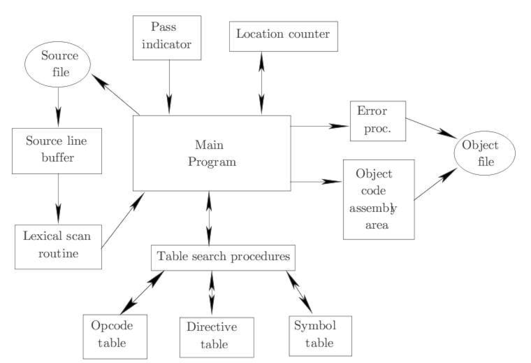

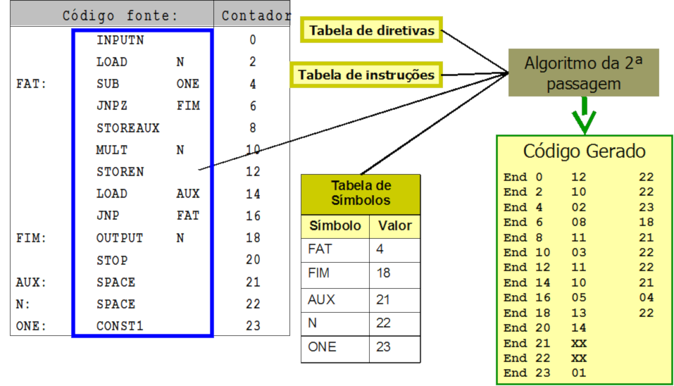

> [!note] obs:
> um program sempre vai começar em alguma posição específica da memória, então, o contador de posição do programa sempre vai iniciar no início da seção de memória reservada pra ele
>
> porém, podemos indicar as posições do código que contêm endereços (**informação de relocação**) e passar a tarefa de indicar o início correto do programa para o **carregador**, deixando em função do ponto de carga (relocação do programa)

vantagens:
- mais simples
- se todos os símbolos de uma instrução já estiverem definidos, seu código de máquina é gerado diretamente

desvantagens:
- toma mais tempo para leitura

## Algoritmo de passagem única

na passagem única, o montador insere um símbolo não definidos na tabela de símbolos, mas também guarda na tabela uma **flag** indicando se está **definido ou não** e um ponteiro para uma lista de endereços que referenciam esse símbolo (**lista de pendências**)

assim, para cada símbolo identificado:
- se não estiver na TS:
  - se for rótulo: adiciona na TS como definido e insere seu valor
  - se for referência: adiciona na TS como não definido e insere posição na lista de pendências
- se estiver na TS:
  - se está definido: insere seu valor no código gerado
  - senão: insere a posição atual na lista de pendências

ao final da passagem, o montador confere se todos os símbolos foram definidos. se sim, insere o valor de cada rótulo nas posições indicadas na sua respectiva lista de pendências; caso contrário, erro de símbolo não definido

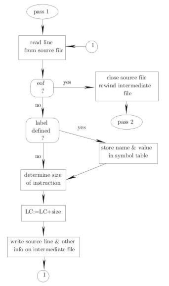

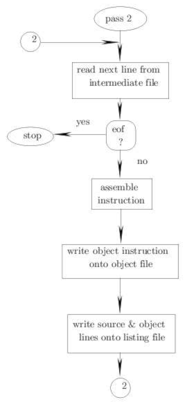

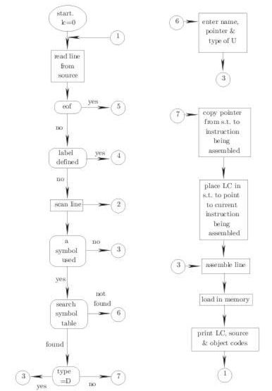

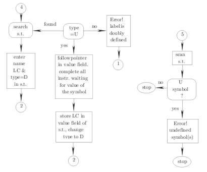

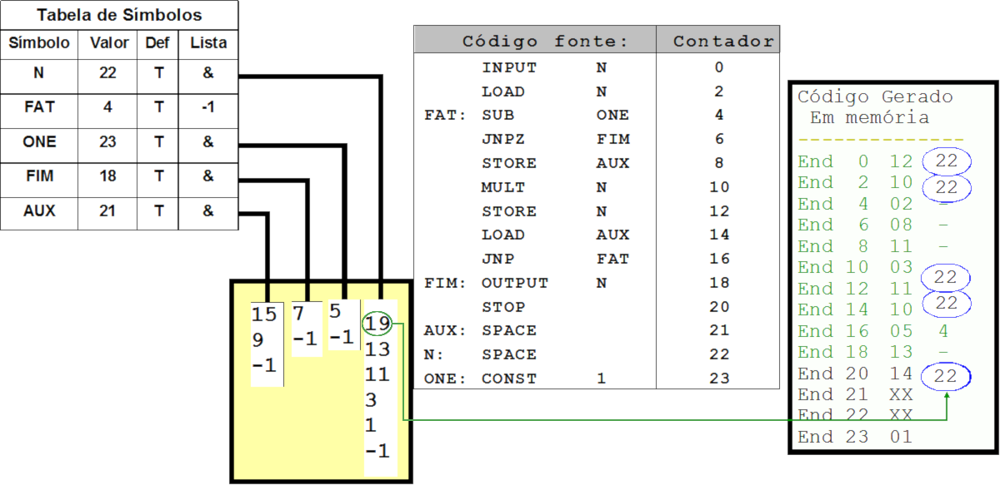

vantages:
- economiza em uma leitura completa do código fonte

desvantages:
- mais complexo
- gasta mais memória (flags, listas encadeadas)

## Algoritmo de indexação (no próprio código)


## Diretivas

diretivas são subrotinas para o montador executar. pode haver diretivas para qualquer passagem de um montador

passagem 0 ou passagem de pré-processamento: consideração de todas as diretivas de pré-processamento

- `SPACE (X)`: reserva o próximo endereço (opcionalmente, +X endereços seguintes a ele) 
- `+X`: soma um valor X ao endereço logo antes
- `ORG X`: define a posição do contador para as instruções a seguir \
  exemplo: definir segmento de texto e dados fixamente

  ```
  ORG 0
  <instruções>

  ORG 32768
  <variáveis>
  ```

- `[SIMB] EQU X` ("equate"): cria um sinônimo para um símbolo, todas suas ocorrências do sinônimo são substituídas pelo símbolo
- `IF [FLAG]` (*conditional assembly*): determina se **uma** instrução do código deve ser montada ou ignorada a partir do valor de uma flag
  ```
  <FLAG> EQU 1  # definição
  . . .

  IF <FLAG>
  JMP XXX     # se <FLAG> não é satisfeita, descarta a linha seguinte
  ```

## MACROs

associam nomes a trechos de código. toda vez que o nome é referenciado no código, o montador deve substituí-lo pelo trecho de código definido. permite a definição de parâmetros e passagem de argumentos

traz um **custo maior de memória** do que chamar uma subrotina, mas costuma ser **mais rápido do que realizar essa chamada** (jump para a subrotina), executar esse código e retornar para o código principal (sem contar com a chance de empilhamento de dados em memória e desempilhamento ao final da subrotina, transferência de execução)

exemplo de definição de MACRO:

```
SWAP:   MACRO           # diretiva de definição de macro
        COPY A, TEMP
        COPY B, A
        COPY TEMP, B
        ENDMACRO        # diretiva de finalização de macro
```

como é meio inútil ter apenas macros com endereços fixos, as macros podem ser parametrizadas

```
SWAP:   MACRO &A, &B, &T    # vamos utilizar & pra denotar parâmetros
        COPY &A, &T
        COPY &B, &A
        COPY &T, &B
        ENDMACRO
```

Macro Name Table (MNT): contém linhas com os nomes de todas macros utilizadas e, opcionalmente
  - o número de argumentos que a macro usa
  - uma referência à linha em que a definição da macro se inicia na MDT
  - referência à última linha da definição da macro (desnecessário se a definição na MDT tem uma diretiva terminal de macro)

Macro Definition Table (MDT): guarda todas as definições das macros do programa

```
MNT                   |   MDT
linha 1: SWAP 3 25    |   linha 25: COPY #1, #3
                      |             COPY #2, #1
                      |             COPY #3, #2
                      |             ENDMACRO
```

os fluxogramas abaixo representam o pré-processamento considerando macros. pra adicionar os 

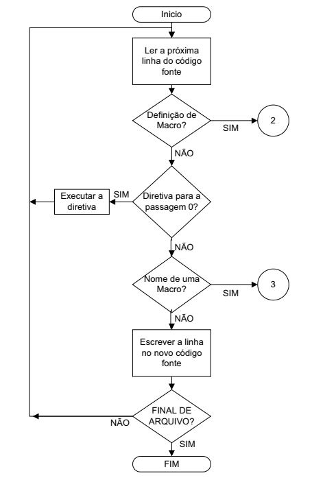

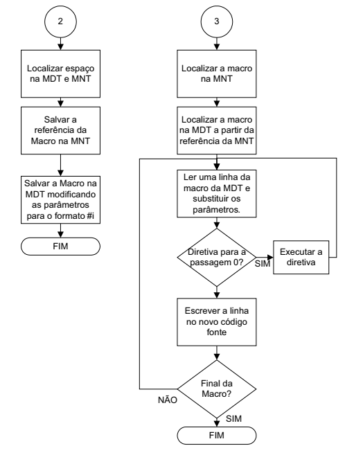

obs: no último passo do fluxograma acima partindo de 3, 

> [!note] observações:
> - tecnicamente, macros também são consideradas no pré-processamento. porém, como as passagens 0, 1 e 2 (a depender do montador) são sequenciais, é possível embutir a expansão de macros na passagem única ou na primeira das passagens (pelo que entendi do q o Bruno falou, é mais uma escolha de design, não é necessariamente mais ou menos otimizado)
> 
> - tipicamente, processadores exigem que macros sejam definidas antes de suas chamadas, permitindo que o processador de macros as expanda em uma única passagem pelo programa

## Fases de compilação do montador

toda linha do assembly inventado tem a estrutura:\
`<rótulo> : <operação> <operandos>; <comentário>`

considerando o algoritmo de duas passagens:
- a passagem 1 é mais próxima da fase de análise, identificando tokens e coletando símbolos do programa
- a passagem 2 é mais próxima da síntese, gerando um código intermediário/objeto correspondente ao fonte

## Acesso a memória (tabelas)

a maior parte do tempo gasto na montagem do programa é o acesso à memória (tabelas de instruções, diretivas e símbolos)

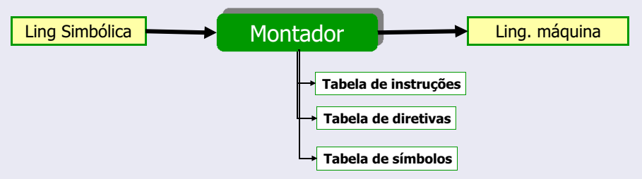

para otimizar esse acesso, precisamos ordernar esses recursos em estruturas de dados adequadas para busca rápida

- lista encadeada: \
  busca sequencial. tempo $\mathcal{O}(N)$; memória $\mathcal{O}(N)$\
  bastante simples, porém muito lento

- árvore binária: \
  busca binária. tempo $\mathcal{O}(\log_2(N))$; memória $\mathcal{O}(N)$ \
  ganho considerável de desempenho, mas **exige que a árvore esteja ordenada**

  | algoritmo      | caso médio         | pior caso                  |
  | -------------- | ------------------ | -------------------------- |
  | selection sort | $\mathcal{O}(N^2)$ | $\mathcal{O}(N^2)$         |
  | quick sort     | $\mathcal{O}(N^2)$ | $\mathcal{O}(N \log_2(N))$ |

- hash table: \
  busca por função hash. tempo $\mathcal{O}(1)$; memória $\mathcal{O}(1)$\
  ótimo para o desempenho, mas complexo (exige a estrutura de hash table, uma função de hash com controle de colisões)

  a função de hash recebe a chave (nome na tabela), gera um número e opera módulo nele (resultado idealmente único), retornando o endereço correspondente na tabela de hash. caso haja colisão de endereços, é formado uma lista encadeada dos resultados das chaves que colidem

  idealmente, a função é boa o suficiente pra distribuir os dados uniformemente e as listas possuem praticamente o mesmo tamanho

  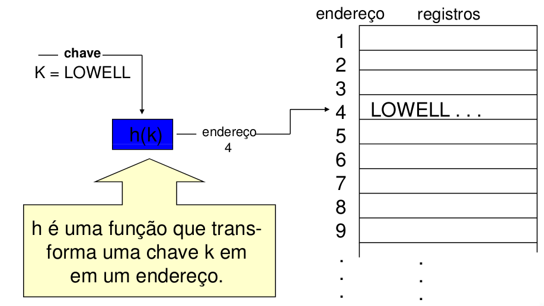

  por exemplo, numa tabela de hash de macros, usamos o nome da macro como chave da função

## Código relocável

para programas maiores, por conveniência, podemos montá-los e armazená-los em partes, para que sejam ligadas posteriormente, antes da execução

após a montagem, podemos indicar quais valores (endereços) são absolutos e quais são relativos (referenciam posições que relativas ao início do programa, em geral rótulos). no código, um valor relativo pode ser $x$, mas no momento que o programa for carregado a partir do endereço $y$, deve passar a apontar para o endereço $x+y$

isso é útil tanto para o ligador quanto para o carregador. essa informação fica em um cabeçalho do código objeto

abaixo, os valores com sufixo `a` são absolutos e com `r` são relativos (devem ser somados ao endereço inicial do programa)

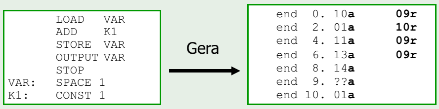

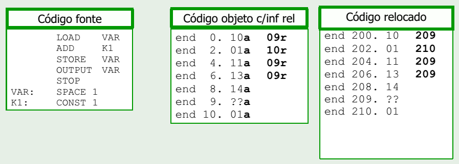


## Montagem e Ligação

um programa pode ser dividido em módulos (seja por organização, separação de rotinas independentes, etc.), que podem ser ligados posteriormente

um montador completo permite montar vários módulos separadamente, gerando um arquivo objeto para cada código fonte. assim, para permitir a integração entre módulos, é possível que cada um exporte e importe símbolos para uso compartilhado.

cross-reference / referência cruzada: referência a uma declaração (rótulo) presente em outro módulo

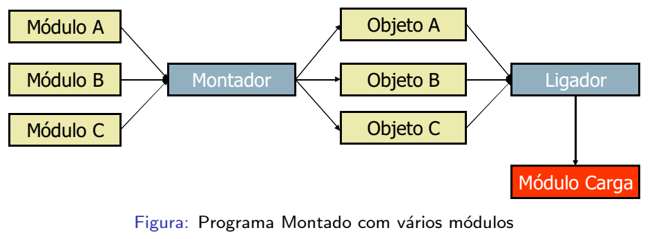

a tarefa de um ligador é:
- juntar vários arquivos objetos em um único executável
- resolver referências cruzadas entre objetos


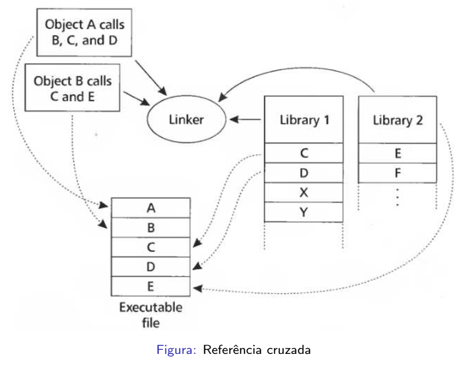


## Resolução de símbolos externos

**Tabela de uso**: indicam símbolos externos usados no módulo; contém:
- nome do símbolo
- endereços que o referenciam

**Tabela de definição**: indica símbolos públicos e seus atributos (fração da TS); contém:
- nome do símbolo
- endereço de sua declaração
- flag externo/público

<!-- #TODO: regras de atualizações das tabelas -->

### Primeira passagem

todo novo símbolo externo é inserido na TS inicialmente com valor "zero absoluto"

todo novo símbolo público é inserido na tabela de definições inicialmente com valor zero e flag "externo"

ao fim da primeira passagemm, copia os valores da TS para a tabela de definições

### Segunda passagem

toda referênica a símbolo externo é registrada na tabela de uso. é anotado nome e posição com referência externa (endereço) que deve ser resolvida na ligação


### Diretivas

| diretiva | descrição                                  | ação                                             |
| -------- | ------------------------------------------ | ------------------------------------------------ |
| `EXTERN` | indica símbolo externo utilizado no módulo | insere rótulo na TS com valor "zero absoluto"    |
| `PUBLIC` | declara símbolo exportado pelo módulo      | insere símbolo na tabela de definições sem valor |
| `BEGIN`  | define o início de módulo                  |                                                  |
| `END`    | define fim de módulo                       |                                                  |


### Exemplo de módulos
```
; Código fonte do módulo A:
; <endereço relativo pós-montagem> <rótulo>: <instrução> <operadores>

00  MOD_A:  BEGIN
00  Y:      EXTERN          ; cabeçalho de símbolos
00  MOD_B:  EXTERN
00          PUBLIC  VAL
00          PUBLIC  L1      ; fim do cabeçalho
00          INPUT   Y
02          LOAD    VAL
04          ADD     Y
06          STORE   Y + 2
08          JMPP    MOD_B
0A  L1:     STOP
0B  VAL:    CONST 5
0D          END
0D
```
```
; Código fonte do módulo B:

00  MOD_B:  BEGIN
00  VAL:    EXTERN
00  L1:     EXTERN
00          PUBLIC Y
00          PUBLIC MOD_B
00          OUTPUT Y
02          OUTPUT VAL
04          OUTPUT Y + 2
06          JMP L1
08  Y:      SPACE 3
0B          END
0B
```

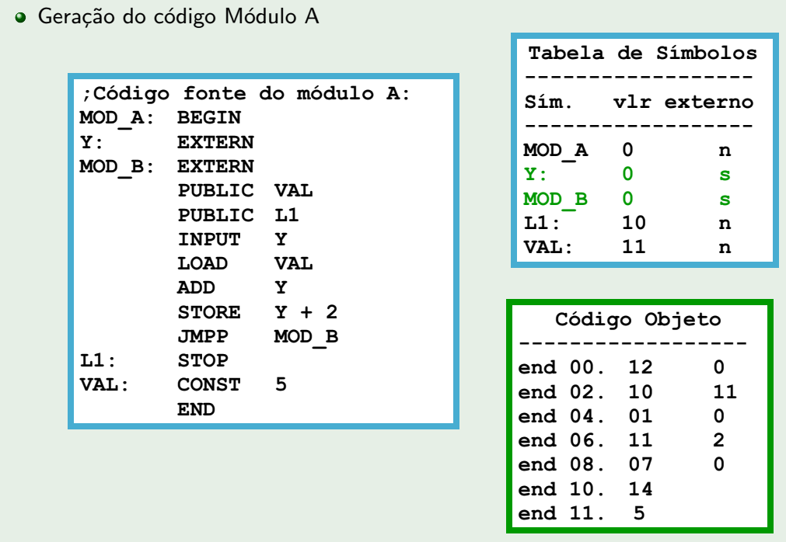

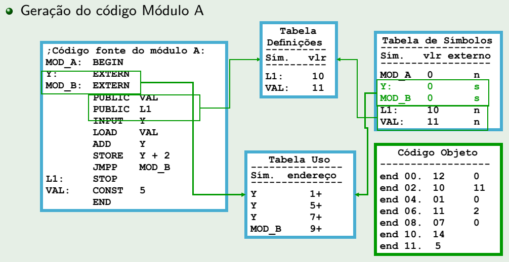

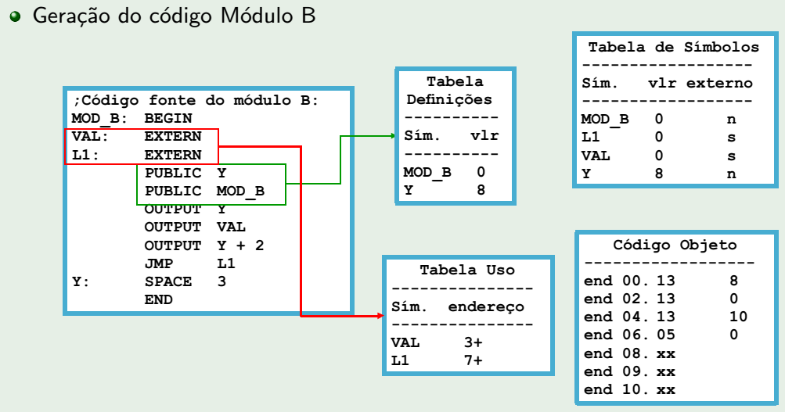

> [!warning] atenção:
> quando o ligador deve resolver uma referência cruzada a um símbolo de outro módulo (externo), ele não substitui o valor do símbolo nos endereços marcados, ele **soma** seu valor aos endereços que o referenciam no código objeto. por exemplo, pra resolver a referência `Y + 2`, com `Y` sendo externo, ele deve primeiro guardar 2 como valor temporário, para então obter o endereço de Y pós ligação, soma Y ao valor temporário guardado

resultado final dos códigos objetos montados:

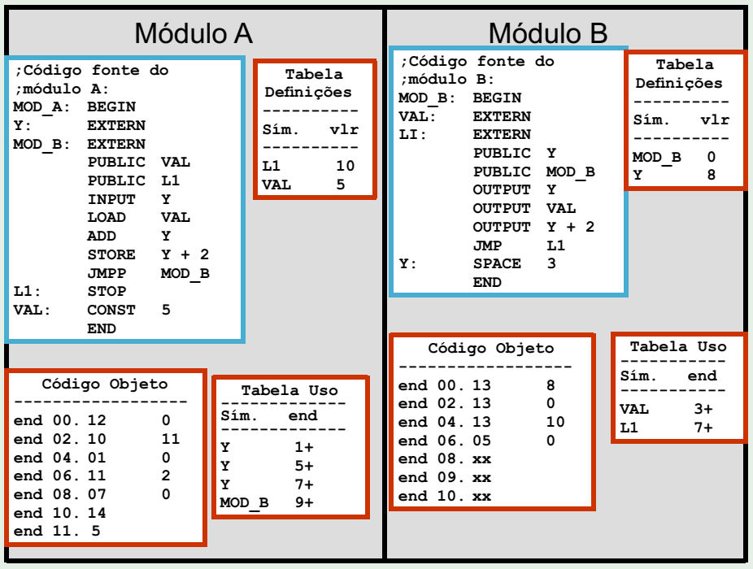

> [!note] obs:
> nessa aborgadem clássica de geração de códigos objetos, cada um tem sua tabela de uso e definições. também é possível gerar uma tabela única para vários módulos (por exemplo a tabela completa de uma biblioteca), mas quando um deles for ligado, vai tomar o espaço da tabela geral de todos os outros módulos agrupados com ele em memória RAM (entendi isso)


# Ligador

na hora de ligar módulos, o produto final será um módulo carga (hoje, batizado como "executável") com a sequência de todos os códigos objetos ligados. em geral, é necessário que o **primeiro trecho seja a rotina *main***, para que o programa possa ser executado a partir do seu início em memória

assim, o ligador deve calcular, para cada módulo alinhado em sequência, um **fator de correção** de seus endereços, para que suas referências a endereços considerem o deslocamento do endereço de início do seu respectivo módulo na sequência

no final do processo de ligação, deve somar o fator de correção a **todos os endereços relativos não alterados nas etapas anteriores** de montagem e ligação (assim que entendi)

além disso, é criada a **tabela global de definições**, que resolve todas as referências cruzadas durante a ligação

> [!note] obs:
> poderíamos criar um código objeto com toda a tabela de símbolos (públicos e externos), não apenas a tabela de definição. isso ofereceria uma versão do programa em "modo debug", pois podemos consultar todas os símbolos e valores durante execução de forma centralizada (é o que entendi), mas toma mais espaço em memória

## Algoritmo

<!-- #TODO: descrever algoritmo de resolução de símbolos externos -->


1. alinha códigos objetos
2. monta tabela com fatores de correção
3. monta tabela global de definições (considerando fator de correção)
4. para cada objeto:
   1. corrige referências registradas na tabela de uso usando a tabela global de definições
   2. corrige endereços das instruções com fator de correção
   3. corrige endereços relativos com fator de correção
5. gera código executável

<br>

exemplo da ligação de módulos A e B:

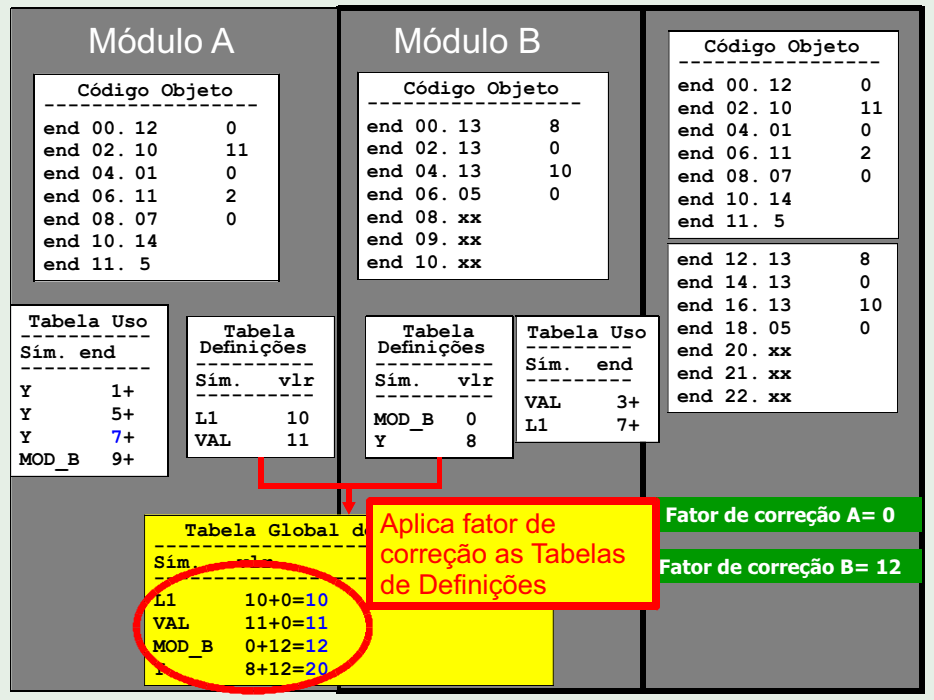

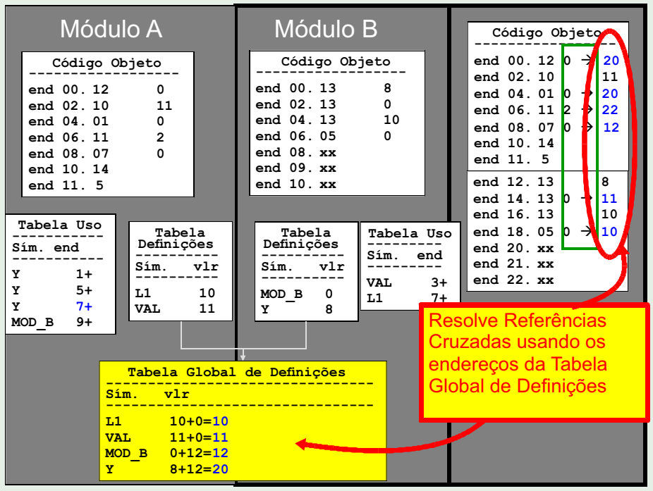

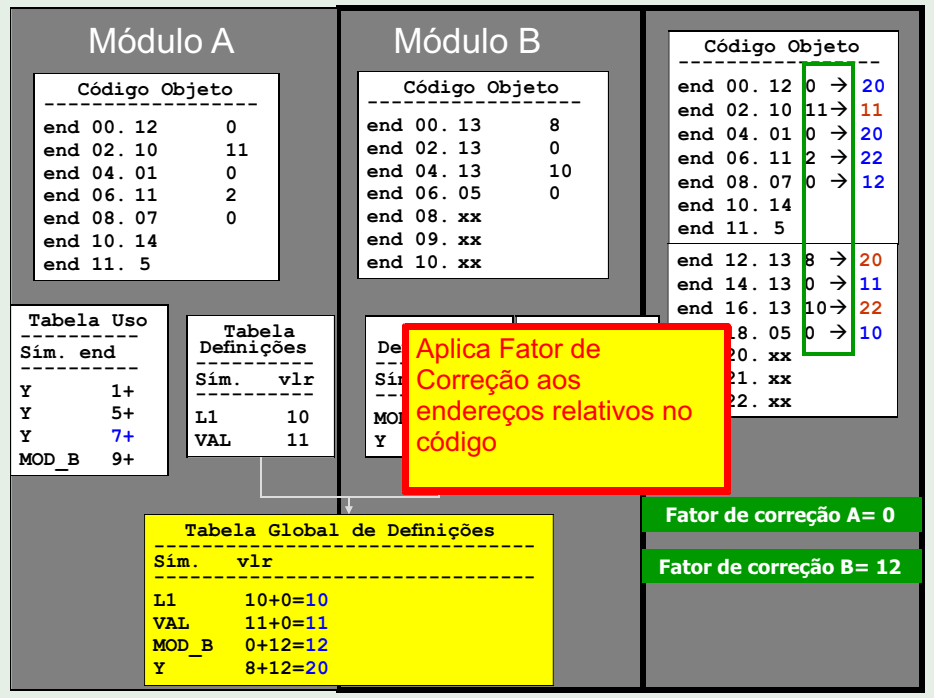

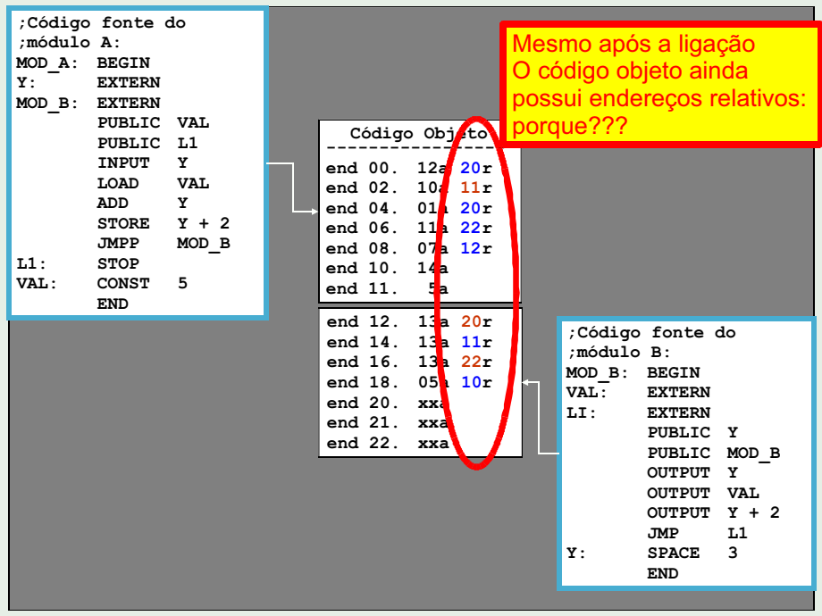

> [!note] obs:
> mesmo após a ligação, o módulo carga tem endereços relativos ao início do programa - devem ser resolvidos pelo carregador


# Carregador

um carregador faz a leitura do código executável em disco e o prepara para execução em memória

temos
- Bootstrap Loader (boot loader): armazenado em ROM/memória não volátil \
  é a BIOS ou firmware. carrega o carregador de sistema operacional, apenas arquivos de tamanho fixo

- Absolute Loader: carrega executáveis apenas em posições definidas da memória \
  carrega o SO em memória RAM

- Relocating Loader: pode carregar executável em qualquer posição da memória \
  implementado em SOs

- Linking Loader: liga e carrega programa a bibliotecas dinâmicas

tarefas do carregador:
- verifica se programa a ser executado existe
- lê o arquivo executável e obtém a quantidade de segmentos de memória necessários para execução
- solicita alocação dos segmentos necessários
- copia o código para a memória
- iniciar variáveis designadas
- 

<!-- ## Progressão do software básico e memória secundária -->

## Bootstrap Loader (boot loader)

armazenado em memória ROM

## BIOS (Basic Input/Output System)

drive A: disquete 5 1/4 polegadas \
drive B: disquete 3 1/2 polegadas \
drive C: HD, e acabou a primeira unidade de memória reconhecida pelo sistema é a C

> [!note] curiosidades:
> disquetes são muito frágeis e sensíveis a interferência eletromagnética. os de 5 1/4" tinham 160 kB. os de 3 1/2" tinham 724 B.
>
> https://pt.wikipedia.org/wiki/Disquete
>
> como produzir um disco magnético de uma face ou dupla-face os discos magnéticos dos disquetes 3 1/2 passaram a ser sempre produzidos como dupla face, 

## UEFI (Unified Extensible Firmware Interface)

primária: registradores, RAM, cache \
secundária: HD, flash drive, qualquer memória manualmente conectada \
terciária: drive conectado por algum sistema automatizado

sequencia de boot do Linux

<br>

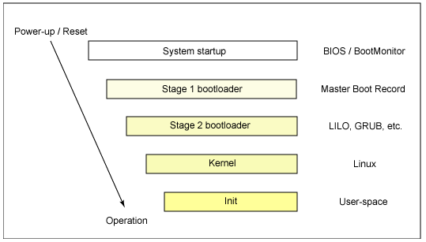

estrutura do MBR

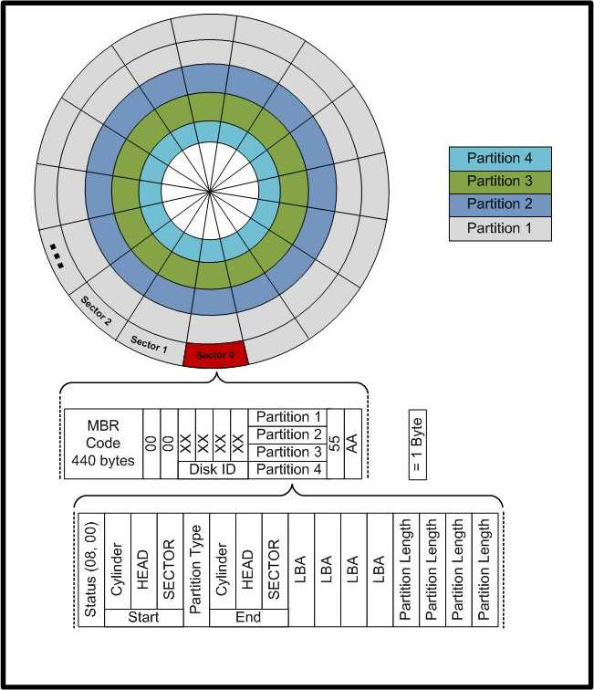


até hoje, os unidades de memória secundárias simulam a organização de um disco magnético, com setores de 512 ou 1024 B

HD: são vários discos magnetizados, de forma que a leitura nos discos é feita nas mesmas regiões de todos os discos simultaneamente, formando uma **coluna**

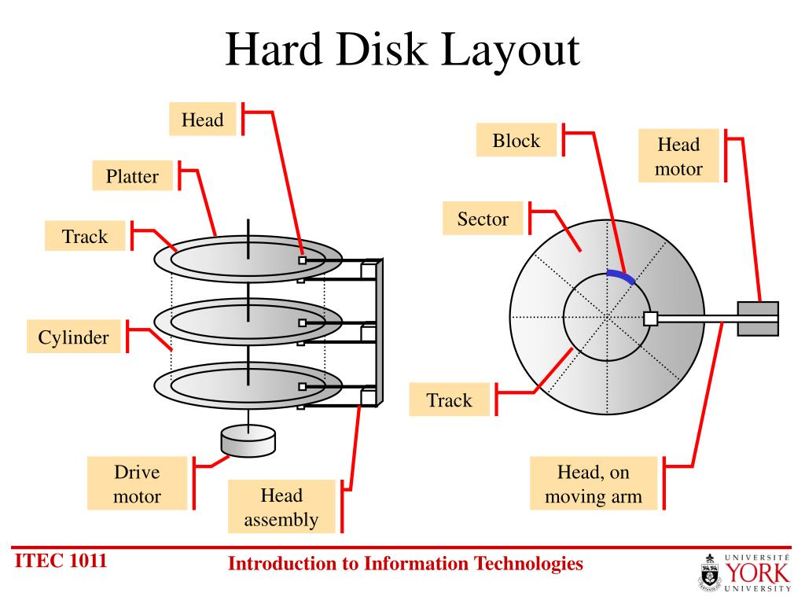

~20ms de deslocamento de um segmento a outro na mesma "angulação" do disco \
~1024 RPM \
todos setores têm a mesma capacidade de memória, para que sempre gire na mesma velocidade. se não tivesse capacidade uniforme por setor, teria que acelerar para a leitura de dados próximos do centro e 

MBR é caregado no setor 0 (absoluto)

no MBR, apenas uma partição podia ser a partição extendida (pode conter outras subpartições lógicas), e toda partição poderia ter até 2 TB

com a necessidade de partições maiores que 2 TB (entre outras necessidades), o MBR foi deixado de lado para utilização do GPT. assim, com o abandono do MBR, se abandona também o POST e a BIOS, fazendo surgir a pilha de firmware, novos bootloaders e organização de memória e partições pelo GPT

porém, ainda se usa convenções do MBR para os estágios iniciais do booting (só em modo legacy ?)

## GUID Partition Table (GPT)


## Carregador absoluto

imagem de memória: cópia exata do sistema para a memória RAM

## Carregador relocador

modifica os endereços relativos de um módulo carga


para não precisar incluir bibliotecas usadas por vários programas diferentes em todos seus módulos carga, gastanto bastante espaço em memória secundária (custando mais tempo para carregar todos os programas) e em memória primária (desperdiçando memória RAM*), podemos deixar pra ligar essas bibliotecas apenas quando carregadas (apenas quando necessário)

> [!note] obs*:
> ainda não sei se DLLs economizam memória primária, talvez elas sejam incluídas em cada programa carregado na RAM, tecnicamente ocupando o mesmo espaço
>
> não sei se chega a ser um problema semelhante com o de funções inline: é igualmente rápido um programa que precisa acessar uma definição de biblioteca na sua respectiva memória reservada em comparação com um que acessa outra região da memória reservada para uma DLL? \
> talvez seja um tradeoff semelhante, custo de tempo e custo de memória
>
> esse possível custo de tempo talvez seja irrevelante em SSDs, já que acessar memória não é um processo mecânico

é possível montar um módulo carga sem ligar as bibliotecas, apenas ligar 

biblioteca dinâmica/compartilhada (Dynamic-Link Library, DLL) p

# Bibliotecas

Estáticas

Dinâmicas


Carregamento estático vs dinâmico \
Ligação estática vs dinâmica (mediante chamada a elemento de biblioteca em execução)

(dynamic linking) vários programas compartilham a mesma cópia de sub-rotina de biblioteca \
vantagem em custo de memória, desvantagem em tempo de execução \
facilita manutenção

em C há bibliotecas e funções dedicadas para a ligação dinâmica: `dlfcn.h` \
para executar uma chamada para ligação dinâmica, em C, fazemos:

1. interrompemos o programa para referenciar a biblioteca \
   usamos `lib_handle = dlopen(path, RTLD_LAZY)` para guardar um ponteiro para a biblioteca

2. interrompemos o programa para referenciar a função a ser chamada \
   usamos `fn = dlsym(lib_handle, func_name)` para guardar um ponteiro para a função \
   ponteiro `fn` deve ser declarado de acordo com a função a ser chamada: deve ser de mesmo tipo e indicar os parâmetros exigidos pela função \
   `tipo_retornado (*fn)(tipo_arg1, tipo_arg2)`

3. chamamos a função pelo seu ponteiro \
   `(*fn)(&arg1, &arg2, ...);`

4. liberamos o ponteiro da biblioteca \
   `dlclose(lib_handle)`


# IA-32

utilizaremos
- compiladro **nasm** (originalmente, proprietário da Intel)
- ligador **ld**

compilação: `nasm -f elf -o hello.o hello.asm`
- `-f elf` determina que o objeto deve ser elf de 32b (*executable and linkable format*) (tem elf64)
- `-hello.o` indica o nome do arquivo objeto de saída
- `-hello.asm` indica o arquivo fonte

ligação: `ld -o hello hello.o` \
se o OS Linux é nativo de 64 bits, a ligação deve ser: \
`ld -m elf i386 -o hello hello.o`

execução: `./hello`


## Estrutura de um programa NASM

```
;brief title of program file name
;       Objectives:
;       Inputs:
;       Outputs:

; declarações de dados com valor inicial declarado no programa
section .data
        (initialized data go here)

section .bss
        (uninitialized data go here)

; dados inicializados como zero
section .text
        (Directives and Instructions go here)
```


## Família de processadores IA-32

Intel nasceu de uma incubadora de empresas de uma universidade americana

| Processador     | Ano  | tamanho de word | memória | frequência | obs                                                                        |
| --------------- | ---- | --------------- | ------- | ---------- | -------------------------------------------------------------------------- |
| Intel 4004      | 1971 | 4               | 640 B   | 740 kHz    | ainda não comercial, projeto de aprendizado                                |
| Intel 8008      | 1972 | 8               | 16 kB   | 800 kHz    |
| Intel 8086      | 1978 | 16              | 1 MB    | 10 MHz     | o nome 86 é por causa da retro-compatibilidade com 8008                    |
| Intel 80286     | 1982 | 16              | 16 MB   | 12.5 MHz   | PC extendido para 20 bits permitiu mem maior                               |
| Intel 80386(DX) | 1985 | 32              | 4 Gb    |            | introduz MMU                                                               |
| Intel 80486(DX) | 1989 | 32              | 4 Gb    |            | configurável para 100% ou 80% da vel. (queimava, surgiu a ideia de cooler) |

com o fracasso nas vendas do Intel 80486, fizeram um re-branding dos próximos processadores para Pentium (depois da 4a geração, veio a 5a). vieram Pentium (1993), Pentium II, Pentium III, Pentium 4, Pentium M, Celeron, Core, Core2 (introduziram multicore), etc.

também vinha a AMD como concorrente:
- AMD IA-32 Processors: \
  K5,K6,Duron, Athlon, Athlon XP
- AMD AMD64 Processors: trouxe uma nova arquitetura de 64b, extendendo o 80386 \
  Sempron, Athlon 64, Athlon 64 X2, Phenom, Turion, Phenom II, Athlon II, Opteron.

a Intel decide desenvolver uma nova arquitetura de 64 bits, abandonando a cadeia de retro-compatibilidade com o Intel 8008. surge o IA-64, com processadores Itanium \
porém, foi uma nova catástrofe, pois empresas de software, como a Microsoft, não quiseram fazer o mesmo esforço e reprogramar tudo para a nova arquitetura e, eventualmente, jogar fora os produtos antigos

no fim das contas, o Itanium foi um dos processadores mais rápidos

## Layout de memória em linux

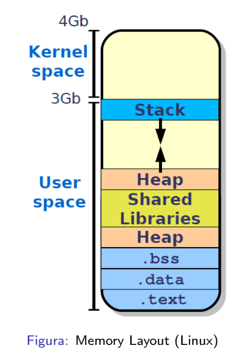

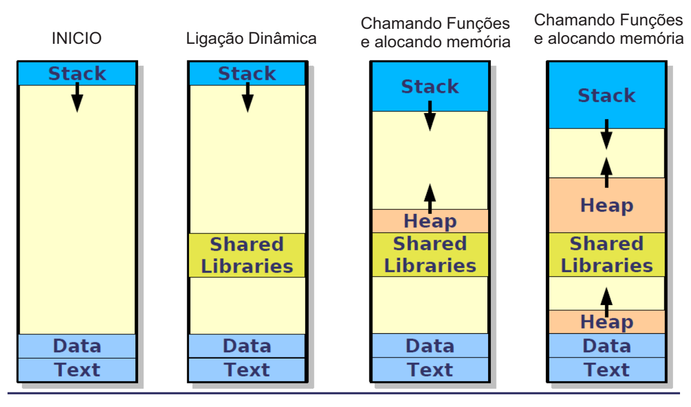

Text \
Initialized Data Segment (.data) \
Uninitialized Data Segment (.bss) \
Stack \
Heap \
Shared/Dynamic Libraries

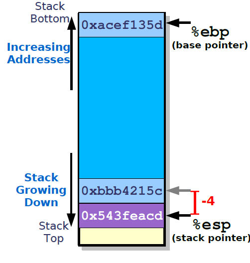

variáveis globais são carregadas no segmento de dados, os demais dados são empilhados na pilha do programa

as bibliotecas dinâmicas/compartilhadas são alocadas entre duas estruturas heap

Doug Lea introduziu o dlmalloc (Doug Lea's Mallloc), alocador de memória de propósito geral, que inspirou o ptmalloc usado na biblioteca GNU C

## Modelo Computacional IA-32

### Registradores

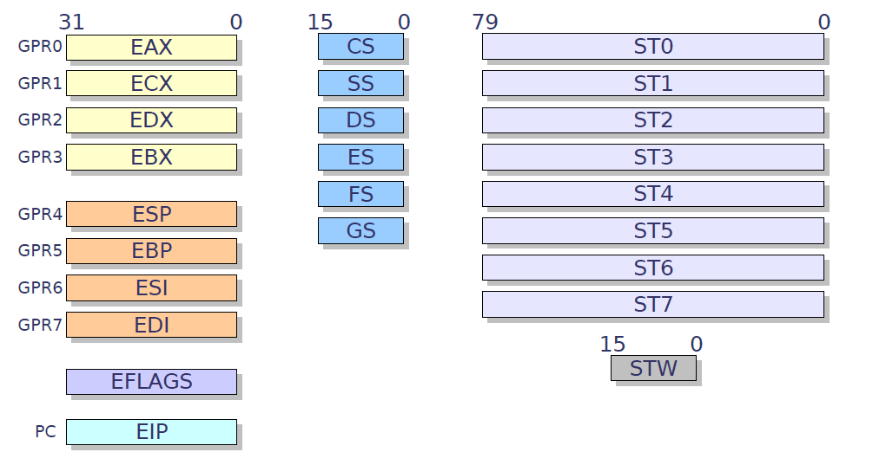

| regs | alias | nome                | função                                                        |
| ---- | ----- | ------------------- | ------------------------------------------------------------- |
| EAX  | GPR0  | accumulator         | acumulador, operandos e resultados de multiplicação e divisão |
| ECX  | GPR1  | count               | contador de laços (contadores não deveriam ir na pilha)       |
| EDX  | GPR2  | data                | operandos e resultados de mult. e divisão                     |
| EBX  | GPR3  | base                | endereço base da estrutura de dados                           |
| ESP  | GPR4  | stack pointer       | topo da pilha de dados                                        |
| EBP  | GPR5  | base pointer        | base da pilha de dados                                        |
| ESI  | GPR6  | source index        | ponteiro para fonte de uma cópia (string)                     |
| EDI  | GPR7  | data index          | ponteiro para destino de uma cópia (string)                   |
| EIP  |       | instruction pointer | ponteiro para próxima instrução                               |

o prefixo `E` (como em `ESP`) é de *Extended*, pois todos eram versões extendidas dos registradores do Intel 80286 (16 bits compatível com 8 bits)

#### Registradores de dados e ponteiros

os registradores `EAX`, `ECX`, `EDX` e `EBX` (registradores de dados) são projetados pra manter retro-compatibilidade com a arquitetura 8086, que por sua vez é compatível com a arquitetura de 8 bits (8008). por exemplo, `EAX` engloba um registrador `AX` de 16b (menos significativos), que por sua vez pode ser dividido em duas metades `AH` e `AL` (*high* e *low*)

o sufixo `X` é um *placeholder* pra representar tanto `H` quanto `L`

Fonte: https://keleshev.com/eax-x86-register-meaning-and-history/

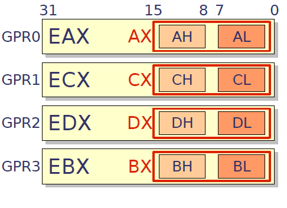

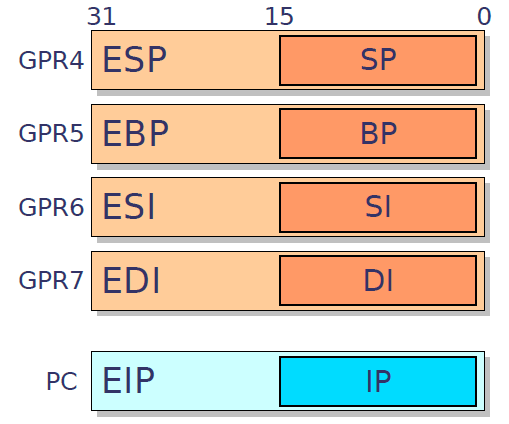

registradores de segmento

| regs       | nome                | função                                             |
| ---------- | ------------------- | -------------------------------------------------- |
| CS         | code segment        | ponteiro do segmento de código atual               |
| SS         | stack segment       | ponteiro do segmento de pilha atual                |
| DS         | data segment        | ponteiro para o segmento de dados atual            |
| ES, FS, GS | extra data segments | adicionais para segmentos distantes (vídeo por ex) |

#### Registradores de segmento (protegidos)

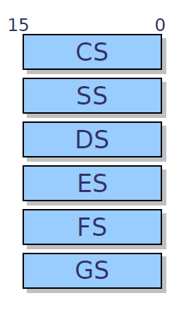

#### Registradores de flags (read only)

status flags (**stat**): relacionadas a operações aritméticas \
control flags (**ctrl**): mudam o comportamento do processador em determinadas instruções (std, cld) \
system flags (**sys**): acessadas exclusivamente pelo kernel


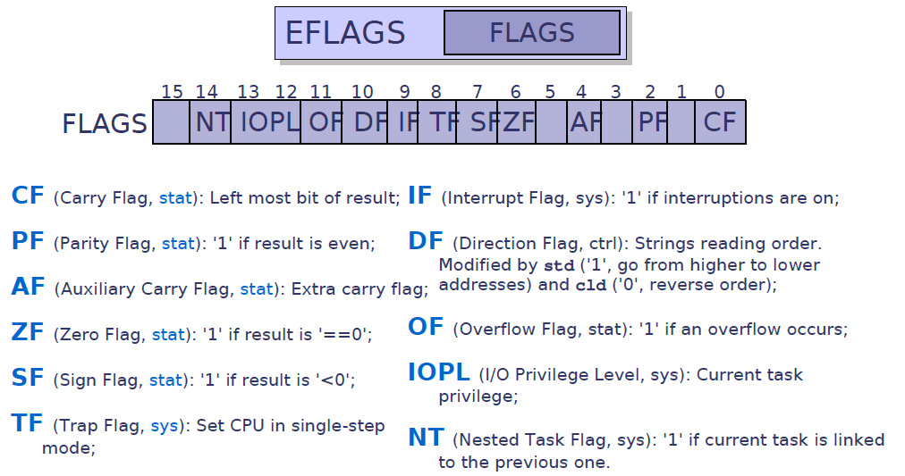

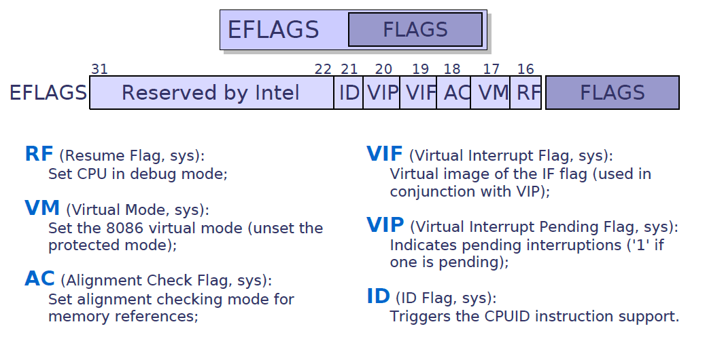

#### Registradores de ponto flutuante

80 bits \
somente acessado como pilha (não diretamente) \
decomposição em $(\text{sign}) M * 10^e$

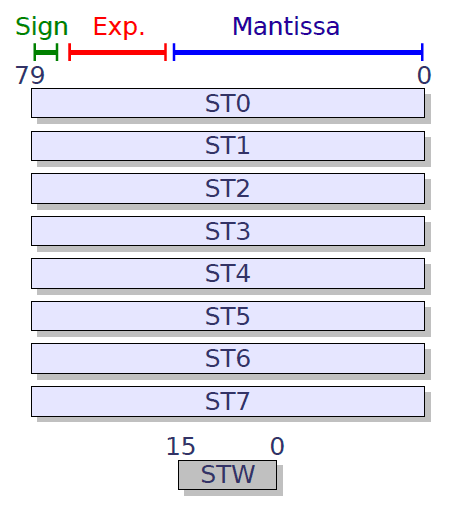

#### Registrador STW


<!-- #TODO: descrever os cabeçalhos de código objeto e módulo carga -->
cabeçalho do programa
- indicação de quais endereços do programa são relativos
- tabela de definições 
